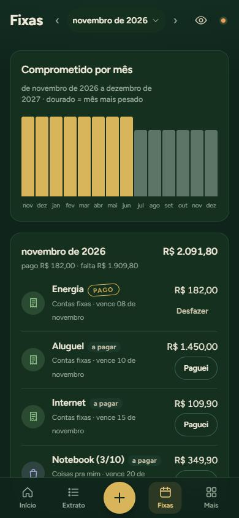
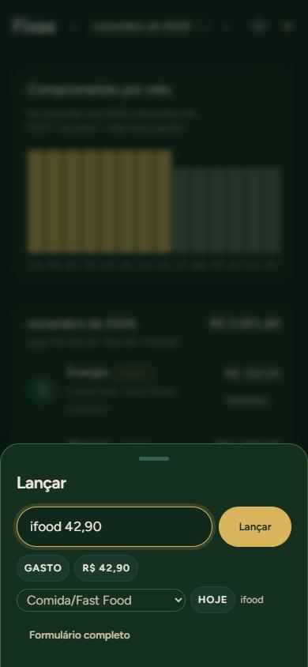

# Sobrou

**Controle de dinheiro com cara de app de banco, feito para responder uma pergunta: para onde foi o meu dinheiro este mês?**

App web instalável (PWA) para iPhone e computador. Funciona offline, sincroniza na nuvem e não depende de framework nem de etapa de build.

🔗 **Ao vivo:** https://painel-do-meu-dinheiro.vercel.app

<p align="center">
  
  
  
</p>
<p align="center">
  
  
</p>

<sub>Prints com dados fictícios.</sub>

---

## O que ele faz

- **Raio-X do mês.** Quanto saiu, quanto entrou, quanto sobrou e a comparação com o mês anterior no mesmo trecho de dias. Uma faixa colorida mostra o peso de cada categoria.
- **Os que mais pesaram.** Agrupa os gastos por lugar (o mesmo mercado, o mesmo app) e mostra quanto cada um subiu ou caiu.
- **Detalhe por categoria.** Gráfico por semana, lista de compras e dica de onde dá para cortar.
- **Extrato.** Busca, filtros por tipo e categoria, agrupado por dia. Arrastar a linha apaga, com opção de desfazer.
- **Contas fixas e parcelas.** Gráfico do valor comprometido nos próximos meses, botão "Paguei" e aviso de conta atrasada. Reconhece no extrato a conta que já foi paga.
- **Lançamento rápido.** Basta digitar `ifood 42,90`: o app entende o valor, a data e o tipo, sugere a categoria e aprende com o que você escolhe.
- **Importação de extrato.** Aceita CSV e OFX do banco ou o texto copiado do app. O que ele não reconhece fica esperando você classificar. Ele nunca chuta.
- **Nuvem e offline.** Grava na hora no aparelho e sincroniza com o Supabase. Os dados de dois aparelhos se juntam item por item, sem um sobrescrever o outro.
- **Modo discreto.** Um toque no olho esconde todos os valores, para abrir o app em público.
- **Movimento.** Números que contam até o valor, transições entre abas, folhas que fecham arrastando. Respeita `prefers-reduced-motion`.

## Stack

| Camada | Escolha |
| --- | --- |
| Interface | HTML, CSS e JavaScript puro (ES modules), sem framework e sem build |
| Dados | `localStorage` primeiro, Supabase (Postgres + Auth por código no e-mail) para sincronizar |
| Offline | Service worker que busca na rede primeiro e cai no cache quando não tem internet |
| Hospedagem | Vercel (site estático) |
| Testes | `node:test`, nativo do Node, sem dependências |

## Arquitetura

A regra é simples: **a lógica fica em funções puras e testáveis, a tela só desenha.**

```
js/
  base.js        datas, categorias, normalização de texto
  formato.js     moeda, porcentagem, rótulos de mês e dia
  raiox.js       agrupa por categoria e por lugar, compara períodos, sugere cortes
  fixas.js       contas fixas e parcelas: ocorrências, pendências, pagamento
  rapido.js      entende a linha digitada no lançamento rápido
  juntar.js      junta o estado de dois aparelhos item por item (último a editar vence)
  sincronia.js   sincroniza com a nuvem com controle de versão e repetição em conflito
  pareamento.js  leva o login do Safari para o app instalado no iPhone
  navegacao.js   abas e subtelas
  movimento.js   animações, transições e gestos
  telas/         cada tela é uma função que recebe dados e devolve HTML
  painel.js      liga tudo: estado, eventos, render
testes/          um arquivo de teste por módulo
```

Algumas decisões que valem a explicação:

- **Sem framework.** O app é pequeno o bastante para não precisar de um, e assim abre instantâneo até em conexão ruim. Cada tela é uma função `dados → HTML`, o que deixa as telas testáveis no Node sem navegador.
- **Junção por item, não por arquivo.** Cada lançamento carrega o próprio carimbo de edição e as exclusões viram marcas. Assim, editar no celular e no computador ao mesmo tempo não perde nada.
- **Login no iPhone.** O app instalado na tela inicial não vê a sessão do Safari, onde o link do e-mail abre. O `pareamento.js` resolve isso com um código de uso único que o Safari entrega e o app busca.

## Rodar localmente

Precisa só do Node 22 ou mais novo.

```bash
npm test                     # 109 testes
node ferramentas/servir.mjs  # abre em http://localhost:4173
```

Sem login, os dados ficam só no navegador. A chave em `js/config.js` é a chave pública do Supabase. O acesso aos dados é protegido por Row Level Security no banco.

## Processo

O projeto foi feito em ciclos: especificação, plano de implementação e execução com testes primeiro (TDD), com revisão no fim de cada ciclo. Os documentos estão em [`docs/superpowers`](docs/superpowers).

---

Feito por [@rafaangelao](https://github.com/rafaangelao) como projeto de estudo.
